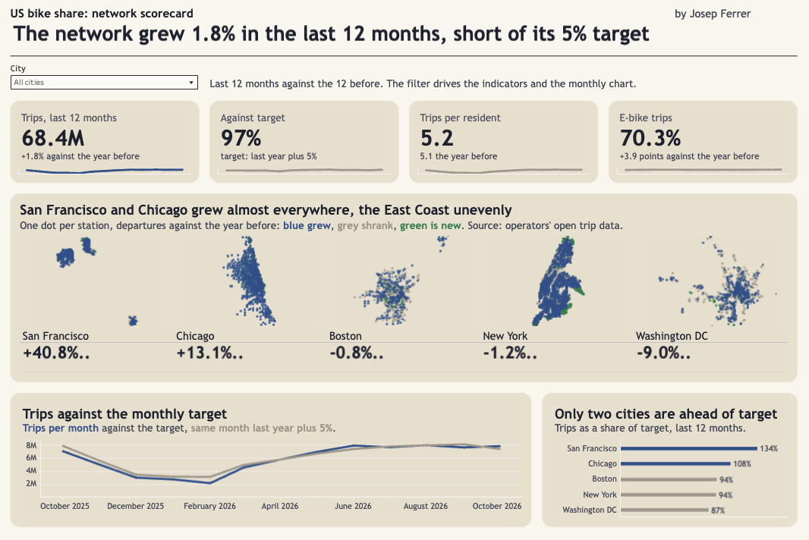
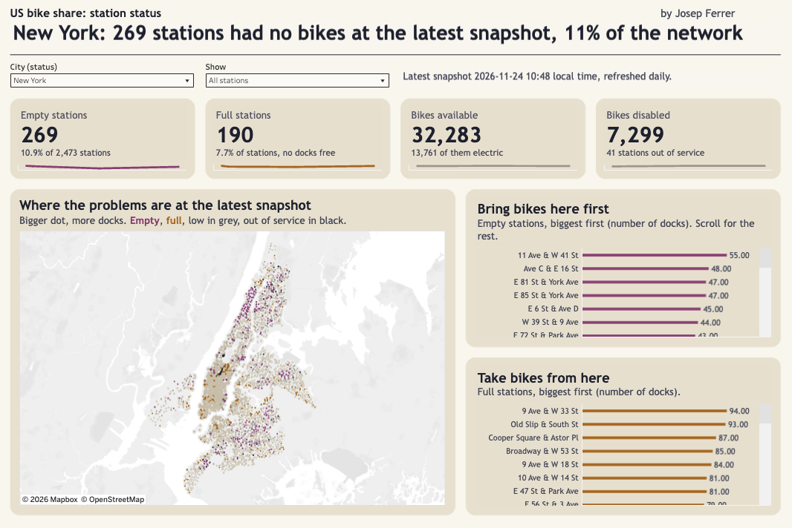
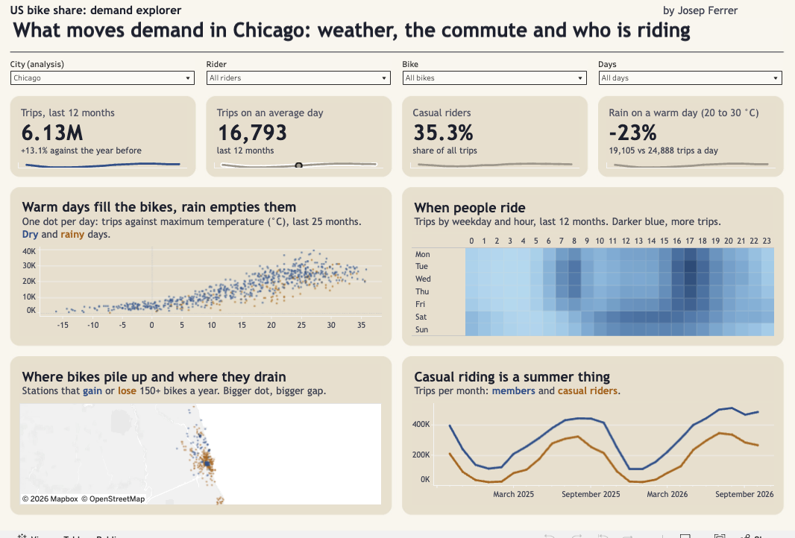
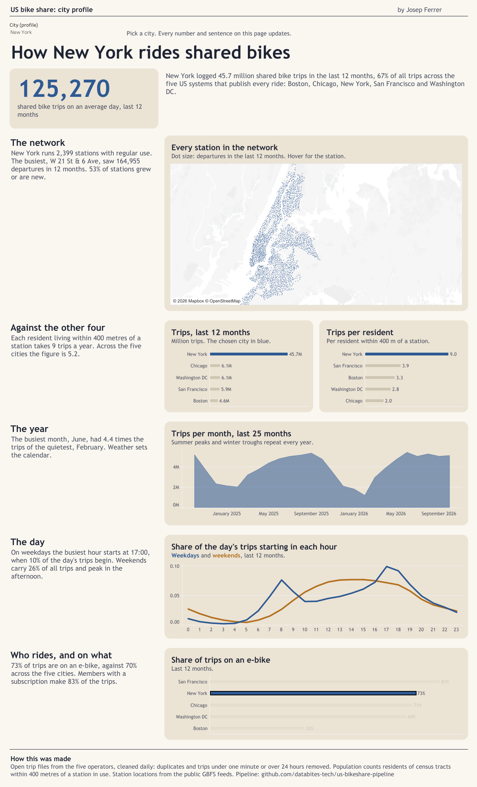

# US bike-share pipeline

Automated pipeline for the five large US bike-share systems operated by Lyft Urban Solutions:
Citi Bike (New York), Divvy (Chicago), Capital Bikeshare (Washington DC), Bay Wheels (San Francisco)
and Bluebikes (Boston). It fetches and cleans the public data, builds summary tables and publishes
them to Google Sheets, which feed four Tableau Public dashboards (strategic, operational, analytical
and informative) that refresh by themselves.

```
Trip files (monthly) ─┐
Stations (GBFS)      ─┤   GitHub Actions          data/tables/*.csv      Google Sheets      Tableau Public
Station status      ─┼─▶ (Python + DuckDB)  ──▶  committed to the repo ─▶ one tab per table ─▶ daily sync
Weather (Open-Meteo) ─┤
Population (Census)  ─┘
```

## Dashboards

Four Tableau Public dashboards, one for each type of dashboard, all fed by the same pipeline and
refreshed once a day.

| | [Strategic](https://public.tableau.com/app/profile/josep.ferrer6407/viz/bikeshare_1_strategic/Strategic) | [Operational](https://public.tableau.com/app/profile/josep.ferrer6407/viz/bikeshare_2_operational/Operational) | [Analytical](https://public.tableau.com/app/profile/josep.ferrer6407/viz/bikeshare_3_analytical/Analytical) | [Informative](https://public.tableau.com/app/profile/josep.ferrer6407/viz/bikeshare_4_informative/Informative) |
|---|---|---|---|---|
| Audience | Network leadership | Rebalancing crews and dispatchers | Planners and analysts | Public, press, city officials |
| Question | Are we growing as planned? | Which stations need bikes or docks today? | What drives demand, and where? | How does my city ride shared bikes? |
| Horizon | Last 12 months against the 12 before | Latest snapshot, last 30 days | Last 25 months | Last 12 months |
| Detail | Network and city | Station | Day, hour, station | City, explained in sentences |
| Interactivity | One city filter | City and problem-station filters | Four filters across every chart | One city picker, the text rewrites itself |

### Strategic: network scorecard

Is the network growing as planned? Trips, progress against a 5% growth target, trips per resident
and e-bike share, with station growth mapped city by city.
[Open in Tableau Public](https://public.tableau.com/app/profile/josep.ferrer6407/viz/bikeshare_1_strategic/Strategic)



### Operational: station status

Where are the empty and full stations? The latest daily snapshot of every docking
station, the 30-day trend of the network, and the stations to refill or empty first.
[Open in Tableau Public](https://public.tableau.com/app/profile/josep.ferrer6407/viz/bikeshare_2_operational/Operational)



### Analytical: demand explorer

What moves demand: temperature and rain, the weekly commute, who rides and on what, and which
stations gain or lose bikes over the year. Filter by city, rider, bike and type of day.
[Open in Tableau Public](https://public.tableau.com/app/profile/josep.ferrer6407/viz/bikeshare_3_analytical/Analytical)



### Informative: city profile

A long-form page for a general audience. Pick a city and every number and sentence updates:
its stations, how it compares with the other four, its year and its day.
[Open in Tableau Public](https://public.tableau.com/app/profile/josep.ferrer6407/viz/bikeshare_4_informative/Informative)



## What runs

| Workflow | When | What it does |
|---|---|---|
| `daily.yml` | Every day, 16:07 UTC (11:07 in New York) | Snapshot of bikes and docks at every station, adds any newly published trip month, refreshes weather, rebuilds the tables, commits `data/`, publishes the **core** and **status** sheets |

Tableau Public syncs Google Sheets once a day, so one daily run is enough. GitHub may delay or skip
scheduled runs; if a day is missed, *Run workflow* by hand.

Raw trips (about 6 to 8 million a month) are never stored: each month is downloaded, cleaned,
aggregated and deleted. The repository keeps a rolling window of 25 months.

## Tables (`data/tables`)

| Table | One row per | Main use |
|---|---|---|
| `kpi_monthly` | city, month | Trips, docked trips, year-on-year growth, target, trips per 1,000 residents |
| `daily_trips` | city, date, rider type, bike type | Trends, weather effect |
| `hourly_profile` | city, month, weekday, hour, rider type | When people ride |
| `station_monthly` | station, month | Departures, arrivals, imbalance (maps) |
| `routes_monthly` | city, month, station pair (top 200) | Flow maps |
| `stations` | station | Name, coordinates, capacity, region |
| `population` | city | Core city and service-area population |
| `weather_daily` | city, date | Temperature, rain, snow, wind |
| `calendar` | date | Weekday, season, US federal holidays |
| `data_quality` | city, month | Rows received, removed and kept |
| `station_summary` | station | Last 12 months: departures, net arrivals, growth, map offsets in km (Tableau) |
| `daily_city` | city, date, rider, bike | Daily trips with weather and day type, readable labels (Tableau) |
| `hourly_city` | city, month, weekday, hour, rider | Hourly profile with readable labels (Tableau) |
| `status_latest` (status sheet) | station | Bikes and docks now, % of time empty or full in 24 h and 7 days |
| `status_city_hourly` | city, snapshot (one a day) | Share of stations empty or full, bikes available |

Join keys: `city`, `date`, `month` and `station_key` (`city:station_id`).

**Sheets and Tableau**: the core sheet only carries the tables the workbooks read (`kpi_monthly`,
`station_summary`, `daily_city`, `hourly_city`) plus small reference tables. Google does not let
Tableau read a Sheet larger than 10 MB, so the large tables live only in this repository.

## Definitions

- **Cleaning**: duplicate ride ids removed; trips shorter than 1 minute or longer than 24 hours removed;
  trips assigned to the month they started in. Times are local to each city.
- **trips** counts every trip. **docked_trips** counts trips that start and end at a station, which is
  the definition the US Bureau of Transportation Statistics publishes. For September 2026 the docked
  counts match BTS within 0.1 to 0.5% in all five systems.
- **target_trips** is the same month last year plus 5% (`target_growth` in `config.yaml`). It is an
  illustrative target for the strategic dashboard, not an official one.
- **service_area_population**: residents of census tracts within 400 m of a station used in the last
  12 months (ACS 2020-2024). Recompute once a year with `python -m pipeline.population`.
- **Known gaps**: New York has no trips on 23 February 2026 (the system was shut during a snowstorm), so
  that day has no rows in `daily_trips`. A few demo stations far from their city are dropped from `stations`.
- **Station states**: `empty` (0 bikes), `low` (2 bikes or fewer), `full` (0 free docks),
  `nearly_full` (2 free docks or fewer). Small e-bike "public racks" are flagged as
  `station_type = public_rack` and left out of the city-level shares.

## Set up

1. **Push this repository** to GitHub (public, so Actions minutes are free). The workflows start on
   their own. Without Google credentials they still update the CSVs and skip publishing.
2. **Google service account**: in Google Cloud create a project, enable the *Google Sheets API*,
   create a service account and download its JSON key.
3. **Two Google Sheets**: create one for the core tables and one for station status. Share each with
   the service account's email as *Editor*, and set *General access* to *Anyone with the link: Viewer*
   so Tableau Public can read them. Paste both sheet IDs into `config.yaml`.
4. **Secret**: in the repository, *Settings → Secrets and variables → Actions → New repository secret*,
   name `GOOGLE_SERVICE_ACCOUNT_JSON`, value: the whole JSON key. Never commit the key file.
5. **Run once by hand**: *Actions → Daily update → Run workflow*.
6. **Tableau**: connect to each Google Sheet, build the dashboard and, when publishing to Tableau
   Public, tick *Keep my data in sync with Google Sheets*.

## Run locally

```bash
pip install -r requirements.txt
python -m pipeline.run_daily              # new months + weather + derived tables
python -m pipeline.run_daily --skip-trips # weather and derived tables only
python -m pipeline.status                 # one station status snapshot
python -m pipeline.publish core           # needs GOOGLE_SERVICE_ACCOUNT_JSON
```

## Data sources and licences

- Trips: each operator's System Data page ([Citi Bike](https://citibikenyc.com/system-data),
  [Divvy](https://divvybikes.com/system-data), [Capital Bikeshare](https://capitalbikeshare.com/system-data),
  [Bay Wheels](https://www.baywheels.com/system-data), [Bluebikes](https://bluebikes.com/system-data)).
  Each operator's data licence agreement applies to the trip data and to the tables derived from it.
- Stations and live status: GBFS feeds at `gbfs.lyft.com`.
- Weather: [Open-Meteo](https://open-meteo.com/) historical weather API.
- Population: US Census Bureau (ACS 5-year 2020-2024, Vintage 2025 population estimates).

The code is under the MIT licence.
